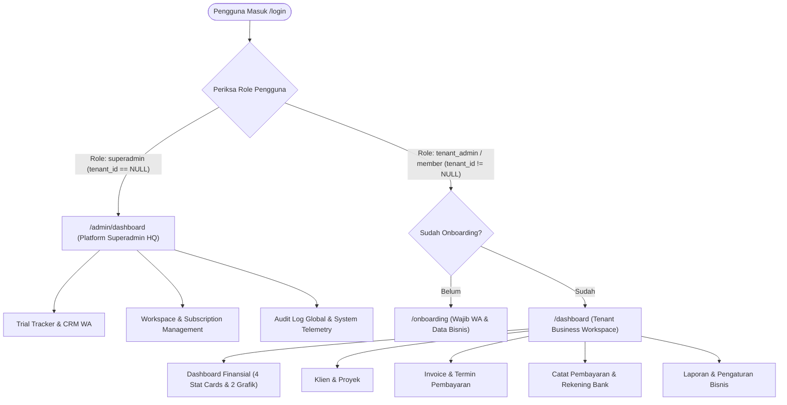

# PRODUCT REQUIREMENT DOCUMENT (PRD)
## Panel Admin & Dashboard Workspace — Synbarra InvoiceRapi

---

## 1. Ringkasan Eksekutif & Visi Produk

**Synbarra InvoiceRapi** adalah platform SaaS penagihan (*invoicing*) dan manajemen termin pembayaran (DP, Termin bertahap, dan Pelunasan) yang dirancang khusus untuk pelaku usaha jasa berbasis proyek di Indonesia (Wedding Organizer, Fotografer/Videografer, Event Organizer, Kontraktor/Interior, dan Konsultan Jasa).

Dokumen ini mendefinisikan spesifikasi perombakan antarmuka **Panel Admin & Workspace** agar presisi 100% mengikuti **Design System Mockup Asli (Tema Violet/Indigo Modern)** serta memisahkan arsitektur hak akses secara tegas antara **Superadmin (Synbarra Platform HQ)** dan **Member / Tenant Admin (Pemilik Bisnis Jasa)**, sekaligus memetakan 6 poin checklist operasional.

---

## 2. Arsitektur Role & Matriks Hak Akses (Dual-Persona)

Aplikasi memiliki dua ranah panel yang terisolasi secara logis dan visual:



### 2.1 Role Matrix Table

| Fitur / Modul | Superadmin (Synbarra HQ) | Tenant Admin / Owner (Member) | Staff Member |
| :--- | :---: | :---: | :---: |
| **Akses URL Portal** | `/admin/*` | `/dashboard`, `/invoices`, dll | `/dashboard`, `/invoices` (view) |
| **Isolasi Database** | Akses Agregat Lintas Tenant | Terisolasi Ketat (`tenant_id`) | Terisolasi Ketat (`tenant_id`) |
| **Financial Privacy** | **DILARANG** membaca detail finansial klien user | Akses Penuh ke pembukuan bisnis sendiri | Akses Terbatas (sesuai izin) |
| **Trial Tracker & Follow-up WA** | ✅ Ya (CRM konversi trial ke berbayar) | ❌ Tidak | ❌ Tidak |
| **Manajemen Tenant/Workspace** | ✅ Suspend, Extend Trial, Upgrade Paket | ❌ Hanya profil workspace sendiri | ❌ Tidak |
| **Manajemen Klien & Proyek** | ❌ Tidak | ✅ Tambah, Edit, Arsipkan | ✅ Baca & Tambah |
| **Pembuatan Invoice & Termin DP** | ❌ Tidak | ✅ Buat, Terbitkan, Batalkan | ⚠️ Sesuai izin draft |
| **Pencatatan Pembayaran** | ❌ Tidak | ✅ Catat Bayar & Void | ⚠️ Catat saja (tidak bisa void) |
| **Pengaturan Rekening Bank** | ❌ Tidak | ✅ Kelola Rekening Transfer | ❌ Tidak |
| **Paket & Billing Langganan** | ✅ Kelola Master Paket | ✅ Upgrade / Perpanjang | ❌ Tidak |

---

## 3. Spesifikasi UI/UX Panel Member (Sesuai Mockup Asli)

### 3.1 Layout & Design Tokens (Violet Modern)
- **Background Utama**: `bg-[#F8FAFC]` (Slate 50) dengan aksen card putih murni `bg-white` border `border-slate-200/80` dan shadow halus `shadow-sm rounded-2xl`.
- **Primary Brand Color**: `Violet-700` (`#6D28D9`) dan `Violet-600` (`#7C3AED`) menggantikan tema dark-teal lama.
- **Typography**: Inter / Plus Jakarta Sans. Font angka finansial menggunakan tabular lining `font-mono` atau `tracking-tight`.

### 3.2 Struktur Navigasi Sidebar (Member Panel)
1. **Header Sidebar**: Logo resmi `Synbarra InvoiceRapi` (Horizontal Badge Ungu).
2. **Menu List**:
   - 📊 **Dashboard** (`/dashboard`)
   - 👥 **Klien** (`/clients`)
   - 📁 **Proyek** (`/projects`)
   - 📄 **Invoice** (`/invoices`)
   - 💳 **Pembayaran** (`/payments`)
   - 📈 **Laporan** (`/reports`)
   - ⚙️ **Pengaturan** (`/settings`)
3. **Bottom Widget (Subscription Status)**:
   - Card gradien ungu muda:
     - Icon Mahkota `👑 Paket Pro`
     - Teks: `Aktif hingga 12 Mar 2026` (atau hitung mundur sisa hari trial)
     - Tombol link: `Kelola Langganan →`

### 3.3 Komponen Top Navbar
- **Workspace Switcher Dropdown**: Menampilkan nama bisnis aktif (contoh: *Mulia Event Organizer*) dengan avatar bisnis.
- **Notification Bell**: Badge angka merah untuk invoice jatuh tempo hari ini.
- **User Profile Pill**: Inisial avatar user (contoh: `RK`), nama, dan dropdown logout.

### 3.4 Main Dashboard Grid (Sesuai Mockup Gambar 2)
1. **Welcome Header**:
   - `Dashboard`
   - `Selamat datang kembali, [Nama Bisnis] 👋`
   - Date range selector: `[Jan 2025 – Jan 2026 📅]`
2. **4 Stat Cards Utama**:
   - **Total Tagihan**: `Rp 125.000.000` (Icon berkas invoice ungu muda)
   - **Sudah Dibayar**: `Rp 78.000.000` (Icon checklist hijau muda)
   - **Piutang**: `Rp 47.000.000` (Icon jam pasir oranye/kuning muda)
   - **Terlambat / Overdue**: `Rp 12.000.000` (Icon api/warning merah muda)
3. **2 Widget Visualisasi Data**:
   - **Grafik Pendapatan Bulanan (Area / Line Chart)**:
     - Header metrik: `Rp 78.000.000` dengan badge tren `↑ +24% dari bulan lalu`.
     - Sumbu X: 6 bulan terakhir (Agu, Sep, Okt, Nov, Des, Jan).
     - Sumbu Y: 0 s/d 100 Jt.
     - Styling: Garis ungu solid (`#7C3AED`) dengan dot lingkaran dan area gradien transparan ke bawah.
   - **Donut Chart Status Invoice**:
     - Tengah Donut: Total jumlah invoice (contoh: `32 Invoice`).
     - Legenda Status:
       - 🟢 **Lunas**: 18 (56%)
       - 🟡 **Sebagian (Termin Berjalan)**: 6 (19%)
       - 🔴 **Belum Bayar**: 5 (16%)
       - ⚪ **Draft**: 3 (9%)

---

## 4. Analisis & Integrasi 6 Catatan Checklist (Gambar 3)

Berikut adalah spesifikasi teknis dari 6 checklist to-do pada catatan Keep pengguna:

```
[✓] 1. Login by Google
[ ] 2. Rekening (Manajemen Rekening Bank Bisnis)
[ ] 3. Trial Demo Testing (Generator Data Uji Coba)
[ ] 4. Unit Testing (Pest/PHPUnit Suite)
[ ] 5. Email Perusahaan (SMTP / Mailgun Notifikasi)
[ ] 6. Fixing Panel UI/UX (Refactor AdminLayout ke Tema Ungu Mockup)
```

### 4.1 Item 1: Login by Google (OAuth 2.0)
- **Status**: Backend Socialite & database migration `google_id` sudah terpasang.
- **Kebutuhan Setting**: Memasukkan `GOOGLE_CLIENT_ID` dan `GOOGLE_CLIENT_SECRET` dari Google Cloud Console ke `.env` produksi.
- **Alur Kerja**: User masuk via Google → jika akun baru dibuatkan role `tenant_admin` → diarahkan ke onboarding untuk isi nomor WhatsApp dan aktivasi trial 14 hari.

### 4.2 Item 2: Rekening Bank Bisnis (Bank Accounts)
- **Tujuan**: Memungkinkan pemilik usaha memasukkan nomor rekening bank / e-wallet mereka yang akan dicetak pada invoice dan halaman link publik klien (`/i/{token}`).
- **Skema Database yang Dibutuhkan**:
  ```sql
  CREATE TABLE bank_accounts (
      id BIGINT AUTO_INCREMENT PRIMARY KEY,
      tenant_id BIGINT NOT NULL,
      bank_name VARCHAR(100) NOT NULL, -- BCA, Mandiri, BNI, BRI, BSI, QRIS
      account_number VARCHAR(100) NOT NULL,
      account_holder VARCHAR(150) NOT NULL,
      is_primary BOOLEAN DEFAULT TRUE,
      qr_code_image VARCHAR(255) NULL,
      created_at TIMESTAMP,
      updated_at TIMESTAMP,
      FOREIGN KEY (tenant_id) REFERENCES tenants(id) ON DELETE CASCADE
  );
  ```
- **Lokasi Menu**: `Pengaturan` → Tab `Rekening Pembayaran`.

### 4.3 Item 3: Trial Demo Testing (Sample Data Seeder)
- **Tujuan**: Saat user baru selesai onboarding, sediakan opsi **"Muat Contoh Data Demo"** (1 Klien WO, 1 Proyek Wedding, 1 Invoice dengan termin DP 30% - Termin 50% - Pelunasan 20%) agar user langsung memahami alur aplikasi tanpa mengetik manual dari nol.
- **Command Artisan**: `php artisan invoicerapi:seed-demo {tenant_id}`.

### 4.4 Item 4: Unit Testing & Integrity Tests
- **Tujuan**: Memastikan keakuratan finansial matematis (bebas bug desimal/floating point) dan keamanan isolasi tenant.
- **Test Cases Wajib**:
  1. `test_installment_amounts_must_equal_invoice_grand_total()`
  2. `test_payment_updates_balance_due_and_installment_status()`
  3. `test_tenant_cannot_access_other_tenants_clients_or_invoices()`
  4. `test_superadmin_bypasses_onboarding_and_enters_admin_dashboard()`
  5. `test_payment_void_recalculates_balance_without_deleting_history()`

### 4.5 Item 5: Email Perusahaan (Transactional Email)
- **Tujuan**: Pengiriman link invoice ke email klien dan notifikasi reminder H-3 termin jatuh tempo.
- **Konfigurasi Produksi**:
  - Driver: SMTP / Resend / Mailgun.
  - Alamat Pengirim: `billing@invoicerapi.synbarra.com` atau `support@synbarra.com`.
  - Template Email: Responsive HTML berlogo Synbarra InvoiceRapi dengan tombol *Lihat & Bayar Invoice*.

### 4.6 Item 6: Fixing Panel UI/UX
- **Tujuan**: Mengganti tampilan dashboard lama yang masih bertema Corporate Synbarra (warna gelap teal `#01232B` di `/admin/dashboard`) menjadi layout ungu modern sesuai mockup Gambar 2 untuk seluruh member tenant.
- **Pemisahan Layout**:
  - `AdminLayout.vue`: Khusus Superadmin Synbarra HQ (Trial Tracker, Telemetri, Tenant list).
  - `WorkspaceLayout.vue`: Khusus Member / Pelaku Jasa (Dashboard Finansial, Klien, Proyek, Invoice, Pembayaran).

---

## 5. Panduan Step-by-Step Pengerjaan di PC Kantor

Berikut adalah urutan teknis terstruktur yang dapat Anda jalankan saat berada di PC kantor:

### Tahap 1: Setup Workspace & Git Clone
```bash
# 1. Masuk ke direktori kerja Anda
cd ~/Documents/synbarra

# 2. Pastikan repository lokal terhubung ke remote InvoiceRapi
cd invoiceRapi
git remote -v
# Pastikan origin mengarah ke: git@github.com:hasanarofid/InvoiceRapi.git

# 3. Tarik update kode terbaru yang sudah kita push
git pull origin main

# 4. Install dependensi (jika baru di-clone di PC kantor)
composer install
npm install
```

### Tahap 2: Konfigurasi File Lingkungan (.env)
Pastikan file `.env` di PC kantor memiliki variabel berikut:
```env
APP_NAME="Synbarra InvoiceRapi"
APP_ENV=local
APP_KEY=base64:...
APP_DEBUG=true
APP_URL=http://localhost:8000

# Database Lokal (atau tunnel ke VPS)
DB_CONNECTION=mysql
DB_HOST=127.0.0.1
DB_PORT=3306
DB_DATABASE=invoicerapi_db
DB_USERNAME=root
DB_PASSWORD=

# Google OAuth Credentials
GOOGLE_CLIENT_ID=your_client_id_here
GOOGLE_CLIENT_SECRET=your_client_secret_here
GOOGLE_REDIRECT_URI="${APP_URL}/auth/google/callback"

# Email Configuration
MAIL_MAILER=smtp
MAIL_HOST=smtp.gmail.com
MAIL_PORT=587
MAIL_USERNAME=your_email@synbarra.com
MAIL_PASSWORD=your_app_password
MAIL_ENCRYPTION=tls
MAIL_FROM_ADDRESS="support@invoicerapi.synbarra.com"
MAIL_FROM_NAME="${APP_NAME}"
```

### Tahap 3: Migrasi Database & Seeding
```bash
# Jalankan migrasi tabel inti & auth
php artisan migrate

# Seed akun superadmin default
php artisan db:seed --class=SynbarraSeeder
```

### Tahap 4: Menjalankan Local Dev Server
```bash
# Terminal 1: Laravel Backend
php artisan serve

# Terminal 2: Vite Frontend Hot Reload
npm run dev
```
Buka browser di `http://localhost:8000/login`.
Gunakan kredensial:
- **Email**: `admin@synbarra.com`
- **Password**: `SynbarraSecure2026!`

---

## 6. Roadmap Implementasi Fitur Prioritas (Sprint Checklist)

- [x] **Sprint 1 — Core Foundation**
  - [x] Cropping logo resmi & mockup hero/dashboard.
  - [x] Nginx, SSL domain `invoicerapi.synbarra.com`, dan CI/CD workflow.
  - [x] Database schema: Clients, Projects, Invoices, Installments, Payments, Audit Logs.
  - [x] Login Google OAuth & alur onboarding wajib WhatsApp + 14 Hari Free Trial.
  - [x] Superadmin bypass onboarding & CRM WhatsApp Trial Tracker.
- [ ] **Sprint 2 — Fixing Panel UI/UX (Sesuai Mockup Gambar 2)**
  - [ ] Pembuatan `WorkspaceLayout.vue` bertema Violet `#6D28D9` sesuai mockup asli.
  - [ ] Halaman `/dashboard` member dengan 4 Stat Cards & 2 Chart visualisasi.
  - [ ] Menu Klien & Proyek interaktif dengan modal tambah/edit.
- [ ] **Sprint 3 — Invoice Termin Engine & Rekening Bank**
  - [ ] Form pembuatan Invoice bertahap (DP, Termin 1..n, Pelunasan).
  - [ ] Modul input Rekening Bank Bisnis di Pengaturan.
  - [ ] Halaman publik klien `/i/{public_token}` dengan tombol cetak PDF.
  - [ ] Pencatatan pembayaran & void audit trail.
- [ ] **Sprint 4 — Quality Assurance & Launch**
  - [ ] Pembuatan demo seeder data dummy untuk uji coba user baru.
  - [ ] PHPUnit / Pest automated tests.
  - [ ] Setup SMTP notifikasi tagihan ke klien.
