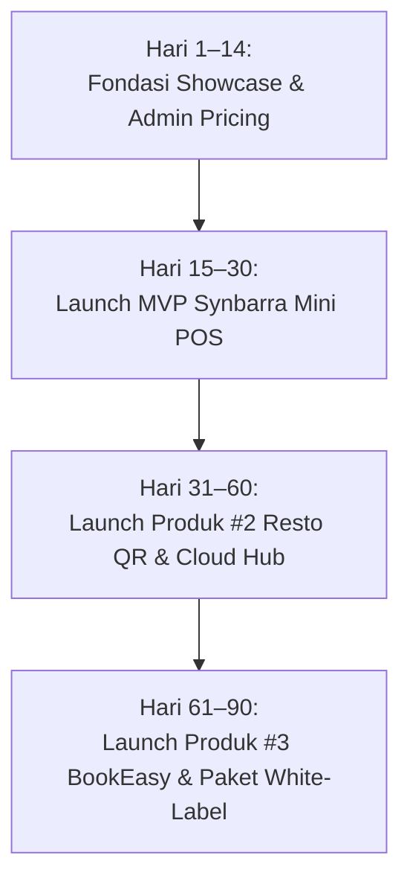

# Product Requirements Document (PRD)
# Lini Bisnis Produk Digital & Software Siap Pakai (Synbarra Digital Products)

**Entitas:** Synbarra Technologies  
**Domain:** [https://synbarra.com](https://synbarra.com)  
**Dokumen:** Product Requirements Document (PRD) — Ready-to-Deploy Digital Products & Mini Software  
**Status:** Approved for Implementation (Revisi Strategis: Dari Template ke Software Siap Pakai)  
**Penulis:** Hasan Arofid (Founder & Tech Lead) & Senior Full-Stack Architect  
**Tanggal:** 4 November 2026  
**Target Rilis:** Q4 2026 – Q1 2027  

---

## 1. Ringkasan Eksekutif & Pivot Strategis

### 1.1 Mengapa Bukan Template, Melainkan Produk Software Siap Pakai?
Berdasarkan evaluasi model bisnis, menjual template tampilan (*design/website template*) memiliki beberapa kelemahan fundamental:
- **Persepsi Nilai Rendah:** Template dipandang hanya sebagai "kulit luar/tampilan visual", dengan perang harga sengit di pasaran (*race to the bottom*).
- **Hambatan Teknis bagi Pembeli Non-Developer:** Pembeli UMKM atau pemilik bisnis bingung menginstal file template mentah (*HTML/Vue zip*) tanpa ada sistem backend dan database aktif.
- **Nilai Solusi Kurang Nyata:** Template tidak langsung menyelesaikan problem operasional harian bisnis.

**Pivot Strategis Synbarra Technologies:**  
Synbarra berfokus memproduksi dan menjual **Produk Digital Software Siap Pakai (Micro-SaaS & Mini Operational Apps)** seperti **Mini POS (Aplikasi Kasir Pintar)**, **Sistem Antrian & Reservasi Bisnis Jasa**, **Katalog QR Dine-In Kafe/Resto**, dan **Mini HRIS/Payroll**.

```
┌───────────────────────────────────────┐         ┌───────────────────────────────────────┐
│     TEMPLATE WEBSITE (DITINGGALKAN)   │         │    PRODUK SOFTWARE (STRATEGI BARU)    │
├───────────────────────────────────────┤         ├───────────────────────────────────────┤
│ • Hanya tampilan UI / file zip        │         │ • Sistem utuh (Frontend, DB, Backend) │
│ • Target sempit (developer/designer)  │  ====>  │ • Target luas (Pemilik bisnis & UMKM) │
│ • Perang harga murah (Rp 50k - 200k)  │         │ • Perceived value tinggi (Rp 500k-5jt)│
│ • ROI bagi pembeli tidak langsung     │         │ • Menghemat operasional & catat uang  │
│ • Peluang upsell service kecil        │         │ • Peluang upsell cloud & custom BESAR │
└───────────────────────────────────────┘         └───────────────────────────────────────┘
```

> **Positioning Baru:**  
> *"Synbarra Digital Products — Practical, Powerful Software for Growing Businesses."*  
> Software siap jalan, tanpa ribet langganan bulanan mahal, mudah digunakan, dan didukung tim engineer berpengalaman.

---

## 2. Analisa Pasar: 5 Produk Digital Software Paling Laris di Indonesia

Berdasarkan analisa kebutuhan operasional UMKM, bisnis ritel, kuliner, dan jasa di Indonesia, berikut 5 produk digital yang memiliki tingkat kebutuhan paling tinggi (*high demand, low churn, high perceived value*):

| No | Produk Digital | Target Pasar Utama | Masalah Krusial yang Diselesaikan | Tingkat Permintaan |
| :-: | :--- | :--- | :--- | :-: |
| **1** | **Synbarra Mini POS (Kasir Pintar & Stok)** | Toko kelontong, butik retail, petshop, apotek kecil, vape store. | Biaya langganan SaaS kasir (Moka/Majoo) dirasa mahal per bulan. Butuh aplikasi kasir ringan, bisa offline, cetak struk Bluetooth, dan kirim nota via WhatsApp. | **SANGAT TINGGI (Prioritas 1)** |
| **2** | **Synbarra Resto QR Hub (Self-Order Meja & Kitchen POS)** | Kafe, kedai kopi, resto keluarga, food court. | Antrian pesanan lambat saat jam sibuk; pelayan kurang. Pelanggan scan QR meja, pesan langsung dari HP, order otomatis tembus ke dapur & kasir. | **SANGAT TINGGI (Prioritas 2)** |
| **3** | **Synbarra BookEasy (Sistem Booking & Antrian)** | Barbershop, salon kecantikan, klinik estetik, car wash, studio foto. | Booking via DM Instagram/WA berantakan; bentrok jadwal kapster/terapis; pelanggan kabur karena tidak ada nomor antrian transparan. | **TINGGI (Prioritas 3)** |
| **4** | **Synbarra StaffLite (Mini HRIS & Payroll WhatsApp)** | Bisnis dengan 5–50 karyawan (toko, gudang, kantor cabang kecil). | Software HRIS korporat (Talenta, Mekari) terlalu mahal dan rumit. Butuh absensi foto selfie GPS, rekap lembur, dan slip gaji PDF otomatis via WA. | **SEDANG-TINGGI** |
| **5** | **Synbarra Mini WMS (Stock Opname & Multi-Gudang)** | Toko grosir, distributor lokal, brand dropshipper. | Selisih stok fisik vs catatan Excel; tidak tahu barang yang hampir kedaluwarsa atau habis; barang hilang tanpa riwayat log. | **SEDANG-TINGGI** |

---

## 3. Batasan Arsitektur & Prinsip Pemisahan Sistem (Architecture Boundary)

Demi menjaga keamanan kode sumber (*Intellectual Property*), kestabilan server *corporate*, serta kecepatan situs pemasaran Synbarra, sistem dipisahkan menjadi dua domain arsitektur:

```
┌────────────────────────────────────────────────────────────────────────┐
│                   REPOSITORY UTAMA: synbarra/synbarra                  │
│             (Web Company Profile, Showcase Produk, & Admin)            │
├────────────────────────────────────────────────────────────────────────┤
│  1. Katalog Publik (/produk)                                           │
│     - Grid produk software (Mini POS, Resto QR, Booking, dll.)         │
│     - Filter solusi industri (Ritel, F&B, Jasa, Operasional)           │
│                                                                        │
│  2. Halaman Detail Produk (/produk/{slug})                             │
│     - Dual Interactive Demo:                                           │
│       * Tombol 1: "Coba Demo Kasir / Tampilan Depan"                   │
│       * Tombol 2: "Coba Demo Dashboard Pemilik / Backoffice"           │
│     - Matriks kompatibilitas hardware (Printer Bluetooth, Scan Barcode)│
│     - Pilihan skema lisensi & kalkulator harga                         │
│     - Tombol Order / Inquiry WhatsApp & Direct Checkout                │
│     - Form konsultasi kustomisasi (Upsell Service)                     │
│                                                                        │
│  3. Admin Portal (/admin/products)                                     │
│     - Setting harga: Sekali Bayar (Lifetime), Cloud Managed, Developer │
│     - Pengaturan URL Demo (Frontend & Admin)                           │
│     - Spesifikasi hardware & fitur modul produk                        │
│     - ID Referensi External Repository (external_repo_id)              │
└────────────────────────────────────┬───────────────────────────────────┘
                                     │ Handshake Webhook / Token API
                                     ▼
┌────────────────────────────────────────────────────────────────────────┐
│              EXTERNAL REPOSITORIES & DISTRIBUTION SERVICE              │
│                  (Private Source Code & Deploy Engine)                 │
├────────────────────────────────────────────────────────────────────────┤
│  • Private GitHub Repositories per produk (Terisolasi dari web utama)  │
│  • Automated Deployment Script / Docker Container Engine               │
│  • Storage Terproteksi (AWS S3 / Cloudflare R2 Presigned Download)     │
│  • Generator License Key & Domain Activator                            │
└────────────────────────────────────────────────────────────────────────┘
```

> **Aturan Arsitektur:**  
> - Repo `synbarra/synbarra` **HANYA** berfungsi sebagai *showcase*, kalkulator harga, demonstrasi fitur, dan *lead generator*.
> - Source code sistem aplikasi produk digital disimpan pada repository Git terpisah dan dikirim kepada pembeli melalui portal lisensi / tautan berbatas waktu (*time-limited signed token*).

---

## 4. Model Monetisasi & Opsi Penetapan Harga

Synbarra menyediakan 3 skema pembelian fleksibel yang ramah bagi bisnis UMKM hingga agensi software:

```
┌───────────────────────────────────────────────────────────────────────────────────────┐
│                           SKEMA HARGA PRODUK DIGITAL SYNBARR                          │
├──────────────────────────┬─────────────────────────────┬──────────────────────────────┤
│    1. PAKET STANDAR      │     2. CLOUD MANAGED        │    3. DEVELOPER LICENSE      │
│  (Lifetime Self-Hosted)  │   (Siap Pakai + Server)     │  (Full Source Code & Rebrand)│
├──────────────────────────┼─────────────────────────────┼──────────────────────────────┤
│ • Sekali bayar           │ • Biaya setup + tahunan     │ • Sekali bayar               │
│ • Pasang di server/PC    │ • Siap pakai tanpa server   │ • Akses penuh source code    │
│   milik pembeli          │ • Hosting & domain Synbarra │ • Hak re-brand untuk klien   │
│ • Update gratis 6 bulan  │ • Backup harian otomatis    │ • Dilarang dijual di pasar   │
│ • Panduan instalasi      │ • Support prioritas         │   terbuka (ThemeForest, dll) │
│                          │                             │                              │
│ Kisaran:                 │ Kisaran:                    │ Kisaran:                     │
│ Rp 499.000 – Rp 990.000  │ Rp 1.490.000 – Rp 2.490.000 │ Rp 3.500.000 – Rp 6.000.000  │
└──────────────────────────┴─────────────────────────────┴──────────────────────────────┘
```

### Potensi Tambahan (Upsell Service Revenue):
1. **Pengadaan Hardware Teruji:** Bundling printer thermal Bluetooth (58mm/80mm) + standing tablet (Margin hardware Rp 150.000 – Rp 350.000/paket).
2. **Jasa Custom Fitur:** Penambahan modul khusus sesuai alur bisnis klien (Tarif custom: Rp 1.500.000 – Rp 10.000.000+).
3. **Maintenance & Training Karyawan:** Pendampingan onboarding staf secara offline/online (Rp 500.000 – Rp 1.500.000).

---

## 5. Rincian Spesifikasi 3 Produk Flagship Pertama

### 5.1 Produk #1: Synbarra Mini POS (Kasir Pintar & Manajemen Stok)
*Sistem Point of Sale modern, ringan, responsif, dan hemat biaya untuk toko ritel & UMKM.*
- **Fitur Kunci:**
  - **Kasir Cepat:** Pencarian produk instan, shortcut kategori, scan barcode kamera HP atau scanner USB.
  - **Multi-Metode Pembayaran:** Tunai, QRIS Dinamis/Statis, Transfer Bank, Debit, dan Catatan Piutang/Kasbon.
  - **Printer & WhatsApp Struk:** Cetak struk via Bluetooth thermal printer (ESC/POS) dan fitur kirim nota belanja via WhatsApp 1-klik ke nomor pelanggan.
  - **Offline-First Sync:** Tetap dapat melayani transaksi kasir saat internet toko terputus; data tersinkronisasi otomatis saat online kembali.
  - **Laporan Bisnis:** Rekap kas harian, laba kotor harian/bulanan, produk terlaris, dan notifikasi stok menipis.
- **Hardware yang Didukung:**
  - Smartphone / Tablet Android, iPad, Laptop Windows / Mac.
  - Thermal Printer 58mm & 80mm Bluetooth / USB / LAN.
  - Barcode Scanner 1D / 2D QR Code.

### 5.2 Produk #2: Synbarra Resto QR Hub (Self-Order Meja & Kitchen Display)
*Sistem pemesanan tanpa antri untuk kafe, coffee shop, resto, dan food court.*
- **Fitur Kunci:**
  - **QR Code per Meja:** Pelanggan scan QR di meja, langsung terbuka menu interaktif tanpa install aplikasi.
  - **Direct Kitchen Order:** Pesanan langsung terkirim ke layar dapur (*Kitchen Display System*) dan printer kasir.
  - **Opsi Pesanan:** Pilihan varian menu (ukuran, level pedas, tambahan topping, catatan khusus).
  - **Split Bill & Bayar Kasir:** Pelanggan bisa bayar langsung via QRIS atau bayar di kasir saat selesai makan.

### 5.3 Produk #3: Synbarra BookEasy (Sistem Reservasi & Antrian Jasa)
*Sistem penjadwalan janji temu otomatis untuk salon, barbershop, klinik, dan studio foto.*
- **Fitur Kunci:**
  - **Kalender Interaktif Publik:** Pelanggan memilih jenis layanan, durasi, tanggal, jam, dan memilih staf/kapster favorit.
  - **Pencegah Jadwal Bentrok:** Jam yang sudah terisi otomatis terkunci.
  - **WhatsApp Reminder:** Notifikasi pengingat otomatis dikirim H-1 dan 2 jam sebelum jadwal janji temu untuk mencegah *no-show*.
  - **Dashboard Antrian Harian:** Tablet display untuk memanggil nomor antrian pelanggan di ruang tunggu.

---

## 6. Spesifikasi Fitur: Halaman Depan Publik (`/produk`)

### 6.1 Halaman Katalog Produk (`/produk`)
- **Hero Banner:**
  - Headline: *"Produk Software Siap Pakai untuk Otomasi & Efisiensi Bisnis Anda"*
  - Sub-headline: *"Tanpa biaya langganan bulanan mahal. Sekali beli, siap pakai untuk kasir, resto, antrian, dan stok bisnis Anda."*
  - Trust Badges: `Sekali Bayar (Tanpa Biaya Bulanan)`, `Bisa Offline`, `Support Printer Bluetooth & WA`, `Garansi & Bantuan Teknis`.
- **Kategori Filter:**
  - `Semua Produk`, `Kasir & POS`, `Kafe & Resto`, `Jasa & Reservasi`, `Operasional & SDM`.
- **Kartu Produk (Product Card):**
  - Badge Status: `Terlaris`, `Siap Pakai`, `Early Bird`.
  - Cuplikan Screenshot Interaktif / Mockup Device Kasir.
  - Judul Software & Deskripsi Singkat Berorientasi Manfaat.
  - Checklist Fitur Utama (3 poin esensial).
  - Label Harga: *"Mulai dari Rp 499.000 (Sekali Bayar)"*.
  - Tombol Aksi: *"Lihat Demo Langsung"* & *"Pelajari Fitur Lengkap"*.

### 6.2 Halaman Detail Produk (`/produk/{slug}`)
- **Header & Visual Interactive Hub:**
  - Galeri mockup tablet kasir, smartphone, dan dashboard admin.
  - Tombol **Dual Live Demo**:
    - `[Coba Demo Kasir (Frontend)]` -> Membuka antarmuka kasir/pemesanan interaktif.
    - `[Coba Demo Dashboard (Admin)]` -> Membuka analitik & manajemen data pemilik.
- **Hardware Compatibility Matrix:**
  - Visual ikon perangkat yang didukung (Android, iOS, Windows, Printer Thermal Bluetooth 58/80mm, Barcode Scanner).
- **Pilihan Paket Pembelian (Interactive Pricing Switcher):**
  - Radio card pilihan paket: Standar (Self-hosted), Cloud Managed (Termasuk Hosting), dan Developer License.
  - Rincian fitur yang didapatkan per paket secara transparan.
- **Modul Kustomisasi & Integrasi Khusus (Service Upsell):**
  - Card penawaran: *"Punya alur kerja khusus atau ingin integrasi sistem kasir dengan ERP perusahaan Anda? Konsultasikan penambahan fitur kustom dengan tim engineer Synbarra."*
  - Tombol WhatsApp dengan format pesan otomatis sesuai produk yang dilihat.

---

## 7. Spesifikasi Fitur: Admin Panel & Setting Harga (`/admin/products`)

Modul backend disesuaikan untuk mendukung data produk software siap pakai:

### 7.1 Penambahan Skema Database (`products` table)
```sql
ALTER TABLE products 
  ADD COLUMN product_type VARCHAR(30) DEFAULT 'software_app', -- 'software_app' | 'service'
  ADD COLUMN demo_url_frontend VARCHAR(255) NULL,           -- URL demo kasir/katalog
  ADD COLUMN demo_url_admin VARCHAR(255) NULL,              -- URL demo dashboard pemilik
  ADD COLUMN external_repo_id VARCHAR(100) NULL,            -- ID repo private distribusi
  ADD COLUMN supported_hardware JSON NULL,                  -- List printer, OS, scanner
  ADD COLUMN key_modules JSON NULL,                         -- List modul sistem
  ADD COLUMN price_lifetime_standard DECIMAL(14,2) DEFAULT 0, -- Sekali bayar self-hosted
  ADD COLUMN price_cloud_managed DECIMAL(14,2) DEFAULT 0,    -- Termasuk server 1 tahun
  ADD COLUMN price_developer_license DECIMAL(14,2) DEFAULT 0, -- Full source code / rebrand
  ADD COLUMN is_offline_ready BOOLEAN DEFAULT TRUE,
  ADD COLUMN documentation_url VARCHAR(255) NULL;
```

### 7.2 Antarmuka Form Admin (`/admin/products/create` & `edit`)
1. **Identitas Software:**
   - Nama Produk, Slug, Kategori Industri, Versi Software (misal: `v1.2.0`).
   - Ringkasan Solusi (untuk SEO & AI GEO).
   - Deskripsi Lengkap Fitur & Alur Kerja.
2. **Pengaturan 3 Tier Harga:**
   - Harga Paket Standar (Self-Hosted Lifetime) + Harga Coret Promo.
   - Harga Paket Cloud Managed (Tahunan include Cloud) + Harga Coret Promo.
   - Harga Developer License (Full Source Code).
3. **Konfigurasi Live Demo & Teknis:**
   - Input URL Live Demo Kasir / Tampilan Depan.
   - Input URL Live Demo Backoffice Pemilik (beserta akun demo siap login otomatis).
   - Input Identifier External Repo / Link Distribusi.
   - Checklist Hardware yang Didukung (Printer Thermal 58mm, 80mm, Barcode Scanner USB/Bluetooth, dll.).
4. **Galeri & Tangkapan Layar:**
   - Upload screenshot tampilan kasir, laporan penjualan, dan pengaturan stok.

---

## 8. Lisensi & Hak Penggunaan Software

| Aspek Ketentuan | Paket Standar (Self-Hosted) | Paket Cloud Managed | Developer License (White-Label) |
| :--- | :---: | :---: | :---: |
| **Batas Penggunaan** | 1 Toko / 1 Entitas Bisnis | 1 Toko / Domain Aktif | Hingga 5 Klien Proyek Agensi |
| **Lokasi Instalasi** | Server / Laptop Milik Pembeli | Cloud Terkelola Synbarra | Server Pembeli / Klien |
| **Akses Source Code** | Kode Terpaket / Terkompilasi | Akses Cloud | **Full Source Code (Bebas Modifikasi)** |
| **Hak Ganti Merk (Re-brand)** | Tidak Boleh | Tidak Boleh | **Boleh (White-Label)** |
| **Dijual Ulang Terbuka** | **DILARANG KERAS** | **DILARANG KERAS** | **DILARANG KERAS (Hanya untuk proyek klien)** |
| **Dukungan Teknis** | 3 Bulan Garansi Bug | 12 Bulan Pemeliharaan Cloud | 6 Bulan Konsultasi Teknis |

---

## 9. Simulasi Potensi Pendapatan

Ilustrasi potensi pendapatan bulanan dari penjualan produk digital software + recurring cloud hosting + upsell jasa custom:

| Skenario | Penjualan Software Standar (@ Rp 750k) | Penjualan Cloud Managed (@ Rp 1.8jt) | Developer License (@ Rp 4.5jt) | Upsell Custom Jasa (@ Rp 3.5jt) | Total Potensi Omzet / Bulan |
| :---: | :---: | :---: | :---: | :---: | :---: |
| **Konservatif (Bulan 1–2)** | 6 unit (Rp 4.5 jt) | 3 unit (Rp 5.4 jt) | 1 unit (Rp 4.5 jt) | 1 klien (Rp 3.5 jt) | **Rp 17.900.000** |
| **Moderat (Bulan 3–4)** | 15 unit (Rp 11.25 jt)| 8 unit (Rp 14.4 jt)| 2 unit (Rp 9 jt) | 3 klien (Rp 10.5 jt) | **Rp 45.150.000** |
| **Skala Penuh (Bulan 5+)** | 30 unit (Rp 22.5 jt) | 15 unit (Rp 27 jt) | 4 unit (Rp 18 jt) | 5 klien (Rp 17.5 jt) | **Rp 85.000.000** |

---

## 10. Roadmap Pelaksanaan 90 Hari



### Fase 1 (Hari 1–14): Fondasi Katalog & Manajemen Harga
- Ubah menu navigasi dan routing utama ke `/produk`.
- Update skema database tabel `products` untuk mendukung setting 3 tier harga software & demo URL ganda.
- Perbarui antarmuka form admin di `/admin/products`.
- Siapkan halaman showcase `/produk` dan template detail produk yang menonjolkan fitur software (bukan template desain).

### Fase 2 (Hari 15–30): Peluncuran MVP Synbarra Mini POS
- Finalisasi core Mini POS (Kasir, stok, Bluetooth printer, WA struk).
- Setup live demo publik (Mode Kasir & Mode Admin).
- Buat video demonstrasi interaktif penggunaan kasir (durasi 60 detik untuk Instagram/TikTok/Threads).
- Buka program Early Bird untuk 15 pembeli pertama dengan bonus gratis setup.

### Fase 3 (Hari 31–60): Peluncuran Produk #2 (Resto QR Hub) & Optimasi Cloud
- Rilis Synbarra Resto QR Hub untuk pasar kafe & kedai kopi lokal.
- Sediakan opsi add-on "Managed Cloud Hosting" (server mandiri siap pakai bagi yang tidak punya teknisi).
- Implementasi SEO lokal & skema Generative Engine Optimization (GEO).

### Fase 4 (Hari 61–90): Peluncuran Produk #3 (BookEasy) & Program Kemitraan Agensi
- Rilis Synbarra BookEasy untuk segmen salon, barbershop, dan klinik.
- Luncurkan paket "Developer & Agency License" untuk rekanan software house / freelancer web.
- Evaluasi metrik konversi dan kepuasan pembeli (*Support Hours per Customer* target < 30 menit).

---

## 11. Checklist Eksekusi Teknis di Codebase

- [ ] **Routing (`routes/web.php`):**
  - Buat rute `/produk` dan `/produk/{slug}`.
  - Rute 301 redirect dari `/template-showcase` ke `/produk`.
- [ ] **Navigasi Global (`resources/js/config/brand.ts`):**
  - Tambahkan label menu `"Produk Software"` atau `"Produk Digital"` ke navigasi header dan footer.
- [ ] **Database Migration:**
  - Buat migration baru untuk menambahkan field pricing tier, link demo ganda, modul fitur, dan status hardware ke tabel `products`.
- [ ] **Admin Controller & Vue (`app/Http/Controllers/Admin/ProductManagerController.php` & `resources/js/Pages/Admin/Products`):**
  - Sesuaikan controller dan form Vue untuk menyimpan harga Lifetime, Cloud Managed, Developer, serta link demo.
- [ ] **Halaman Showcase & Detail (`resources/js/Pages/Products/Index.vue` & `Show.vue`):**
  - Implementasikan UI modern Synbarra (Clean, White, Mint/Teal `#00BFA5`, rounded pill buttons).
  - Tampilkan Live Demo kasir & admin serta simulator lisensi.

